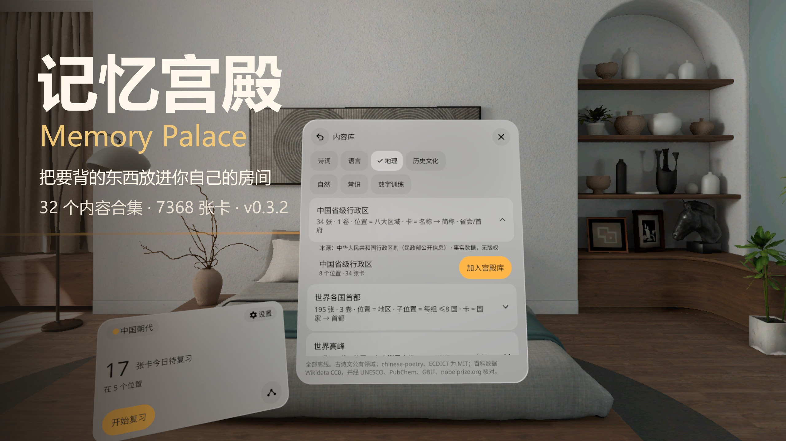
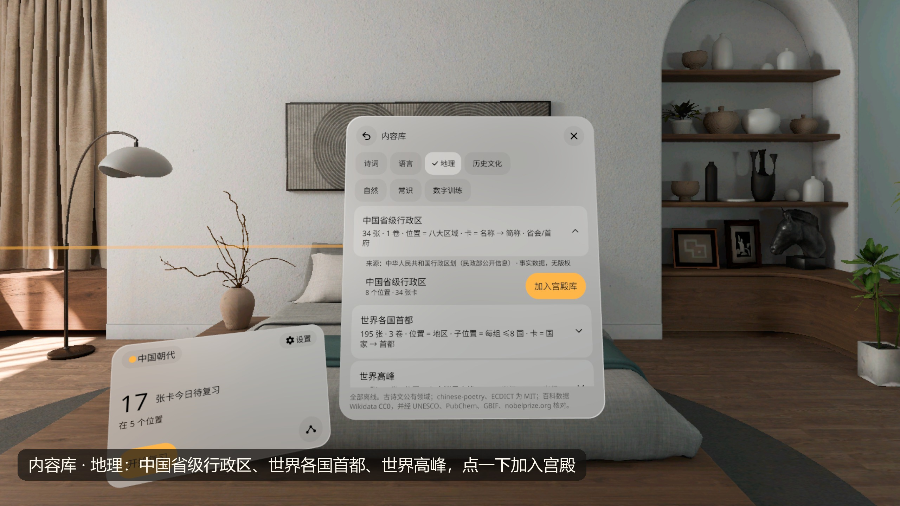
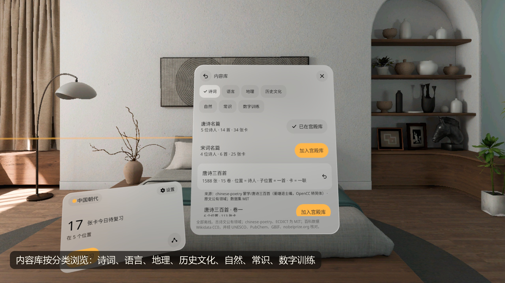
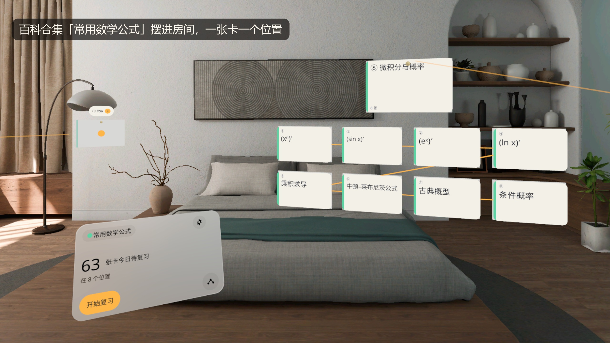
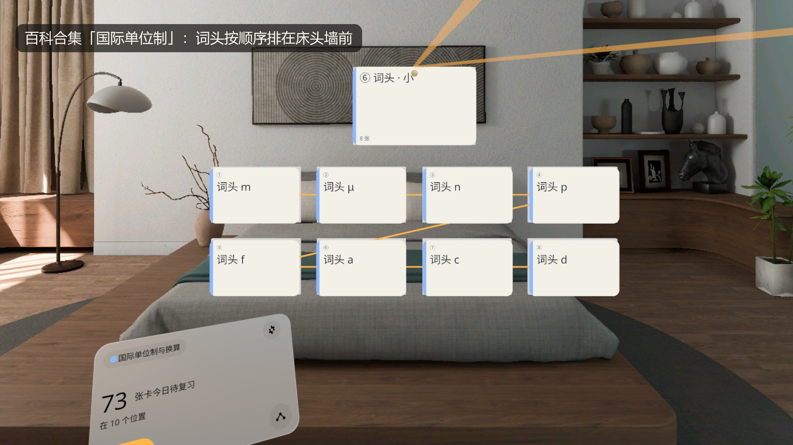
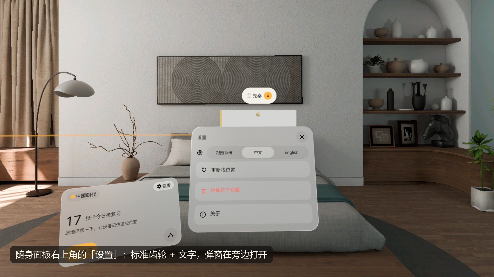
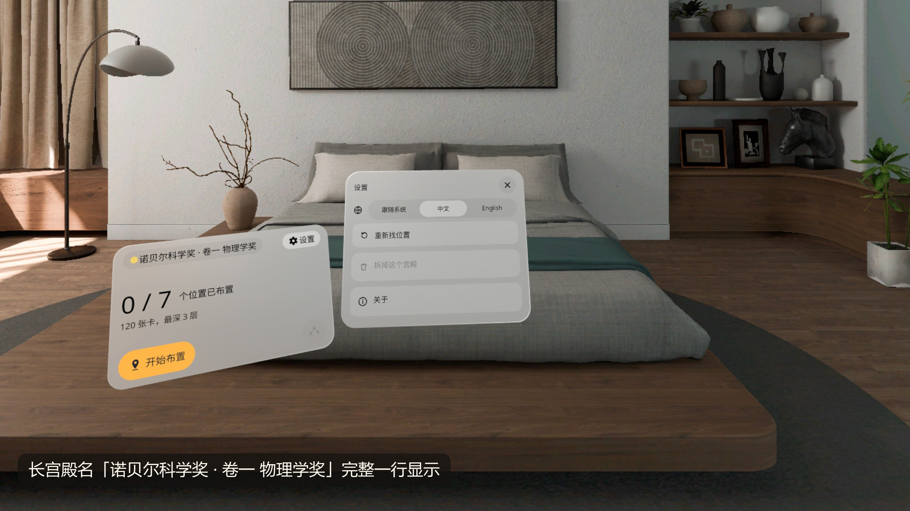

# 记忆宫殿 Memory Palace



**中文** · [English](#english)

把要背的东西做成一座宫殿：用空间锚点把位置钉在自己房间里，连成一条发光的路线。看一眼位置，名牌下浮出预览；捏一下（或扣扳机）就地展开成一组记忆卡，站在哪里都行，不用走过去。走一圈就复习一遍，也可以按路线顺序把整套内容回忆一遍。PICO OS 6 的 MR 应用（Stage · Mixed，只在全空间里运行），无账号。

## v0.3 有什么

- **内容库：32 个现成合集、7368 张卡，全部离线。** 分七类：诗词、语言、地理、历史文化、自然、常识、数字训练。点一下「加入宫殿库」就变成一座宫殿，每个合集展开时写着结构、来源和许可。
  - 诗词：唐诗三百首、宋词三百首、三字经、千字文、论语名句
  - 语言：英语高频 1000 词
  - 地理：中国省级行政区、世界各国首都、世界高峰、世界大河、世界湖泊与沙漠、中国世界遗产、各国货币
  - 历史文化：中国朝代（扩充）、美国总统、世界历史大事、世界名画、科学发现：元素与天体、诺贝尔科学奖
  - 自然：元素周期表 118、太阳系、全天 88 星座、动物分类、人体系统与器官
  - 常识：二十四节气、七十二候、省级行政区别称与面积、国际单位制与换算、常用数学公式
  - 数字训练：圆周率前 200 位、扑克顺序训练、随机数字 100 位（后两个每次随机生成）
- **v0.3.1 新增 16 个百科 / 常识合集（1800 张卡）**：卡上的数字都由脚本从原始数据生成，Wikidata（CC0）优先，再和维基百科、UNESCO、ISO 4217、PubChem、GBIF、nobelprize.org 等核对，对不上的条目直接丢掉。
- **放自己的东西**：建一座空白宫殿，每捏一下钉一个位置；任何位置都能加文字、图片（系统文件选择器）、3D 模型（.glb / .usdz，≤ 25 MB，自动量尺寸放在位置旁或卡上）、子位置。手柄摇杆左右转模型，上下推远拉近放置点。
- **看一眼、捏一下，站在哪里都行**：位置牌都有名牌（编号 + 名字 + 待复习数），远处捏开的格子会转向你并放大到看得清。
- **v0.3.2 新的设置按钮**：随身面板右上角是标准齿轮（中间镂空）加「设置」两个字，打开时有选中底色；设置弹窗和内容库弹窗都开在随身面板旁边，不挡面板。长宫殿名（如「诺贝尔科学奖 · 卷一 物理学奖」）完整一行显示，不出省略号。

v0.2 起就有的：

- 宫殿 → 位置（空间锚点）→ 子位置 → 卡，最深 3 层；预置中国朝代、前 20 号元素、旅行英语
- 用维基百科条目建宫殿（海外网络；章节变位置、句子变填空卡，卡背署名 CC BY-SA 4.0）；中国大陆打不开维基时提示并引导去内容库或文件导入，不接其他在线百科
- 从文件导入：CSV、Anki 纯文本导出、行首缩进 TXT
- 间隔重复：SM-2，凌晨 4 点分日；忘了的卡本轮最后再来一次；评分后 3 秒内可改
- 中英双语界面（跟随系统，可在设置里切换）
- 联网的只有维基百科这一处（`INTERNET` 权限）

## 截图

PICO OS 6.1 模拟器高清截图（2560 宽，QA v0.3.1 / v0.3.2 轮次），中文界面，原图裁成 16:9，没有缩放。

| | |
|---|---|
|  内容库 · 地理：中国省级行政区、世界各国首都、世界高峰 |  七个分类，诗词下有唐诗三百首、宋词三百首等 |
|  百科合集「常用数学公式」摆进房间 |  百科合集「国际单位制」：词头按顺序排开 |
|  新的「设置」按钮和旁边打开的设置弹窗 |  长宫殿名完整一行显示 |

第 3、4 张来自 v0.3.1，随身面板右上角还是旧的设置图标；其余是 v0.3.2。截图由调试命令驱动，**不是真实手势录像**。这一版没有演示视频（现有录像是 v0.3.0，没有新合集和新设置按钮）。

## 安装

需要 PICO OS 6 头显或 PICO 6.1 模拟器。APK 在 [Releases](../../releases) 里（debug 签名）。

```bash
adb install -r MemoryPalace-v0.3.2.apk
pico-cli app launch io.embodit.memorypalace
```

第一次打开会加载锚点（几秒），然后进主页。点「开始布置」，看着想放的地方捏一下就钉一个位置；位置之间至少隔 0.8 米。debug 包在不同电脑上签名不同：如果设备上装的是别的电脑打的包，`install -r` 会失败，要先卸载（会清掉本地宫殿和进度）。

## 已知问题（v0.3.2）

模拟器 QA 发现，都不影响使用：

1. 英文界面下，内容库合集展开后的来源 / 许可说明仍是中文（内容数据没有英文版）。
2. 「返回 / 上一层」和「撤销」两个图标都是向左弯的箭头，长得很像；目前不在同一个面板里同时出现。
3. 英文长宫殿名（如「Nobel Prizes in Science · Vol. 1 Physics」）在顶栏里用小一号的字放下。
4. 设置里「拆掉这个宫殿」是红字灰底，对比度偏低。
5. 位置里有放在卡上的 3D 模型时，标题卡升高，默认站姿下要稍微抬头才看到名字行。
6. 随身面板转身 90° 会出视野，暂时没有「移到面前」。
7. 部分单行文字（维基、导入页面里的提示等）超长时会被直接切掉；本轮截到的界面里没有出现。

## 真机

v0.3.2 已装到 PICO 头显并启动一次、15 秒无崩溃；工厂验收单的真机项已勾。还值得在头显上多看的：

- 真实房间里锚点跨天、关机重开后的保持和漂移
- 眼动悬停浮出的预览卡（模拟器上没有悬停反馈）、手部捏合、60 fps 下的摇杆转速
- 系统文件选择器（导入图片 / 3D 模型 / 文件）在 PICO OS 6 上的表现

## 内容许可

- 古诗文原文为公有领域；chinese-poetry、ECDICT 数据为 MIT。
- 百科数据以 Wikidata（CC0）为主，事实数据核对来源见每个合集的「来源」一行和 `tools/packs/` 的说明。
- 用维基百科建出的宫殿按 CC BY-SA 4.0 使用，每张卡背面署名；debug 包里的维基测试样本（`app/src/debug/assets/wiki`）同样是 CC BY-SA 4.0。
- 字体 Noto Sans / Noto Sans SC：SIL OFL 1.1（[third_party/](third_party/)）。

## 开发

Kotlin + PICO Spatial SDK 6.1.9，所有 2D 界面用 SpatialUI（`PicoTheme`），不用 Material 组件（v0.3.2 的齿轮 / 箭头是 Material Symbols 的矢量图形，转成 drawable）。开发说明、调试命令、QA 截图清单见 [AGENTS.md](AGENTS.md)；设计包和样稿在 [design/](design/)。

---

<a id="english"></a>

## English

Turn what you need to memorize into a palace: spatial anchors pin loci to your own room and a glowing route joins them. Glance at a locus and a preview floats under its name plate; pinch (or pull the trigger) and it opens in place into a grid of memory cards, from wherever you stand. One walk around the room is one review, or walk the route in order and recall the whole set. An MR app for PICO OS 6 (Stage · Mixed, Full Space only). No account.

### What's in v0.3

- **Content library: 32 ready-made collections, 7368 cards, all offline**, in seven categories: Poetry, Language, Geography, History & Culture, Nature, Know-how, Number training. "Add to palaces" turns one into a palace; each collection shows its structure, source and licence when opened.
  - Poetry: 300 Tang Poems, 300 Song Ci, Three Character Classic, Thousand Character Classic, The Analects
  - Language: English Top 1000
  - Geography: Chinese Provinces, World Capitals, Highest Peaks, Great Rivers, Lakes & Deserts, World Heritage in China, World Currencies
  - History & Culture: Chinese Dynasties (extended), US Presidents, World History Events, Famous Paintings, Discoveries: Elements & Moons, Nobel Prizes in Science
  - Nature: Periodic Table, Solar System, The 88 Constellations, Animal Classification, Human Body Systems
  - Know-how: 24 Solar Terms, 72 Pentads, Provinces · Aliases & Area, SI Units & Conversions, Math Formulas
  - Number training: Pi · 200 digits, Card Deck Order, Random 100 Digits (the last two are shuffled each time)
- **v0.3.1 adds 16 encyclopedia / know-how collections (1800 cards)**: every number on a card is generated by script from raw data, Wikidata (CC0) first, cross-checked against Wikipedia, UNESCO, ISO 4217, PubChem, GBIF, nobelprize.org and others; items that don't agree are dropped.
- **Your own things**: start a blank palace, pinch to pin each locus, and add text, pictures (system file picker), 3D models (.glb / .usdz up to 25 MB, measured and fitted beside the locus or on its card) and sub-loci anywhere. The controller stick turns a model (left / right) and moves the placing spot (up / down).
- **Look, pinch, from anywhere**: every locus has a name plate (number, name, cards due); a grid opened from afar turns to you and grows until it is legible.
- **v0.3.2 settings button**: the pocket panel's top-right is a standard gear (hollow centre) with the word "Settings", highlighted while open; the settings and library popups open beside the pocket panel instead of over it. Long palace names such as "Nobel Prizes in Science · Vol. 1 Physics" fit on one line without an ellipsis.

Since v0.2:

- Palace → locus (spatial anchor) → sub-locus → card, up to 3 levels; bundled Chinese Dynasties, First 20 Elements, Travel English
- Build a palace from a Wikipedia article (outside mainland China; sections become loci, sentences become fill-in cards, CC BY-SA 4.0 credit on every back); when Wikipedia can't be reached the app says so and points to the library or file import, with no other online encyclopedia
- Import from files: CSV, Anki plain-text export, indented TXT
- Spaced repetition: SM-2, day starts at 4 a.m.; forgotten cards come back once at the end of the round; a rating can be changed within 3 s
- Chinese and English UI (follows the system, switchable in Settings)
- Wikipedia is the only network use (`INTERNET` permission)

### Screenshots

HD captures from the PICO OS 6.1 emulator (2560 px wide, QA rounds of v0.3.1 / v0.3.2), Chinese UI, cropped to 16:9 without scaling; see the table above. Shots 3 and 4 are from v0.3.1 and still show the old settings icon at the pocket panel's top-right; the rest are v0.3.2. The captures are driven by debug commands, **not recordings of real hand gestures**. There is no demo video for this version (the existing recording is v0.3.0, without the new collections or the new settings button).

### Install

Needs a PICO OS 6 headset or the PICO 6.1 emulator. The APK (debug-signed) is on the [Releases](../../releases) page.

```bash
adb install -r MemoryPalace-v0.3.2.apk
pico-cli app launch io.embodit.memorypalace
```

On first launch the app loads its anchors for a few seconds, then shows Home. Tap "Start placing", look where you want a locus and pinch; loci must be at least 0.8 m apart. Debug builds are signed differently on each machine: if the device has a build from another machine, `install -r` fails and you need to uninstall first (which clears local palaces and progress).

### Known issues (v0.3.2)

Found in emulator QA; none of them blocks use:

1. In the English UI, the source / licence line of an opened collection is still in Chinese (the content data has no English version).
2. The "back / up one level" and "undo" icons are both left-curving arrows and look alike; they never appear on the same panel at the moment.
3. Long English palace names (e.g. "Nobel Prizes in Science · Vol. 1 Physics") fit in the top bar at a smaller size.
4. "Remove this palace" in Settings is red on grey, with low contrast.
5. When an open locus has a 3D model on a card, its title rises; at the default head pose you need to look up slightly to see the name line.
6. Turning 90° takes the pocket panel out of view; there is no "bring to front" yet.
7. Some single-line texts (hints on the Wikipedia and import pages) would be cut if very long; none were in this round's screenshots.

### On a headset

v0.3.2 has been installed on a PICO headset and launched once, 15 s with no crash; the factory's device check is ticked. Still worth checking on a headset:

- Anchor persistence and drift across days and power cycles in a real room
- The gaze-hover preview card (the emulator shows no hover feedback), hand pinch, stick turn speed at 60 fps
- The system file picker (importing pictures / 3D models / files) on PICO OS 6

### Content licences

Classical texts are public domain; chinese-poetry and ECDICT data are MIT. Encyclopedia data is mainly Wikidata (CC0); each collection's source line and `tools/packs/` list what it was checked against. Palaces built from Wikipedia use its content under CC BY-SA 4.0, credited on every card; the debug Wikipedia fixtures (`app/src/debug/assets/wiki`) are CC BY-SA 4.0 too. Fonts Noto Sans / Noto Sans SC: SIL OFL 1.1.

### Development

Kotlin + PICO Spatial SDK 6.1.9; all 2D UI is SpatialUI in `PicoTheme`, with no Material components (the v0.3.2 gear and arrows are Material Symbols vector shapes converted to drawables). See [AGENTS.md](AGENTS.md) for structure, debug commands and the QA screenshot list; the design package and sample are in [design/](design/).
