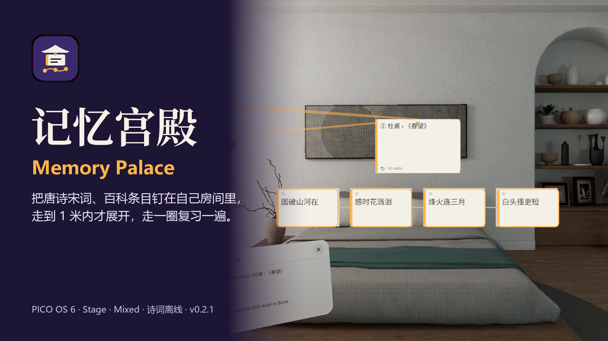
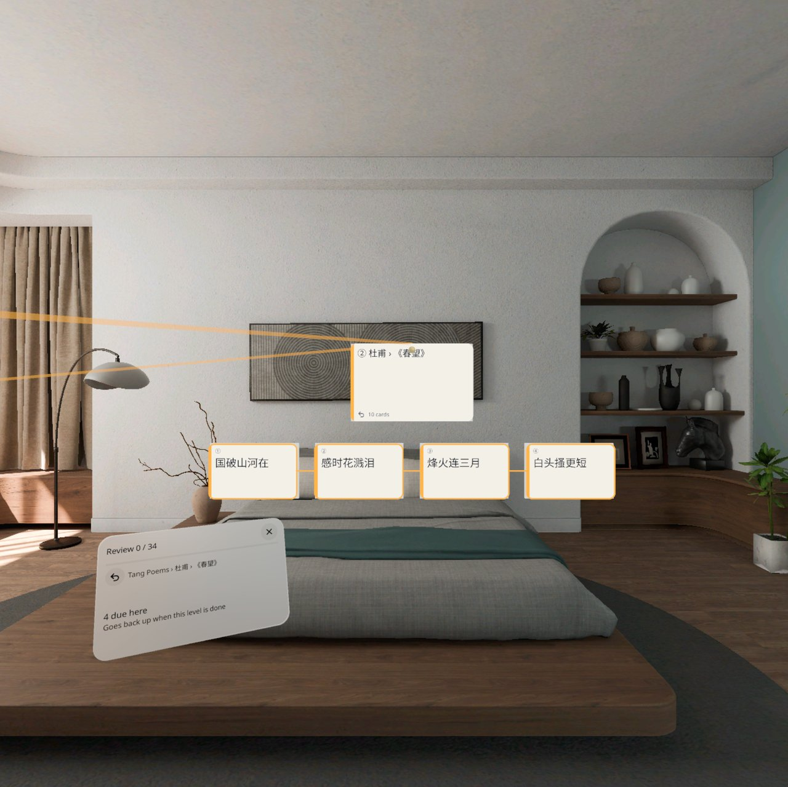
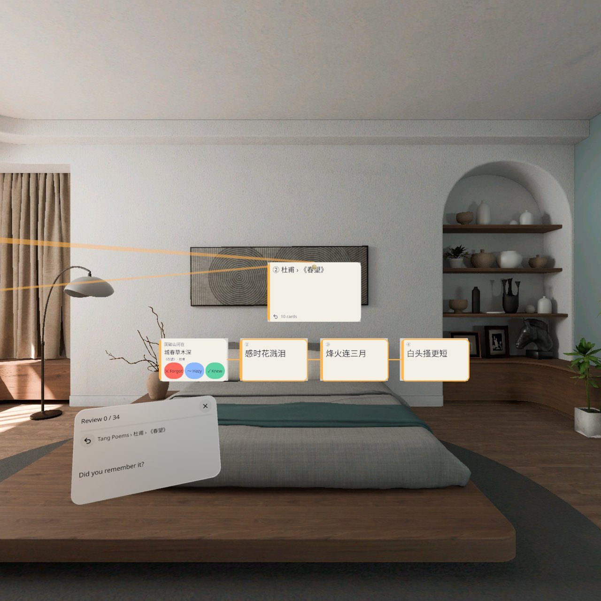
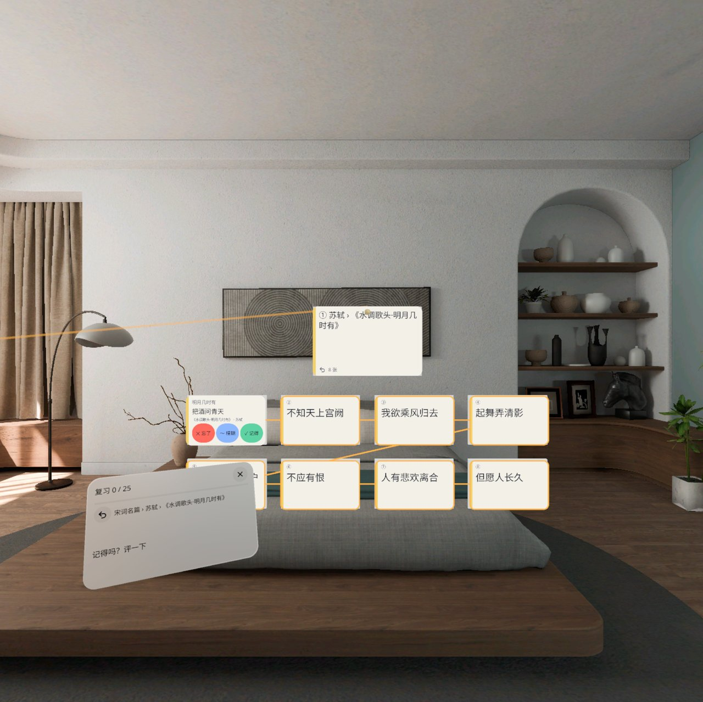
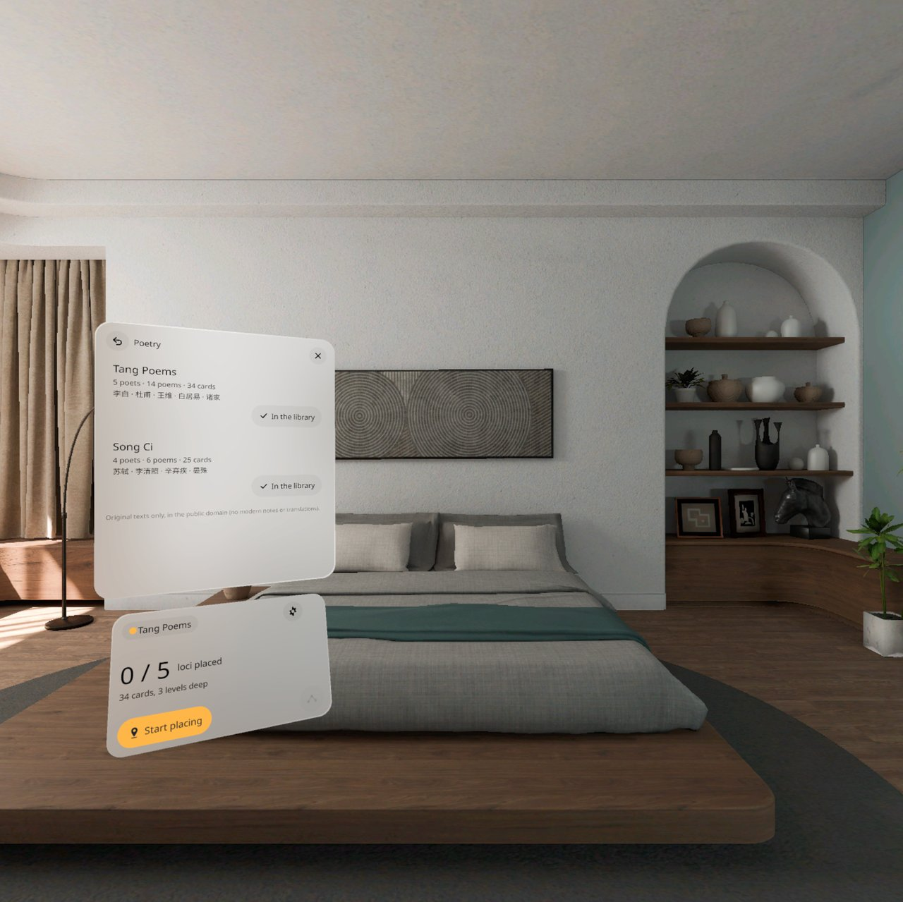
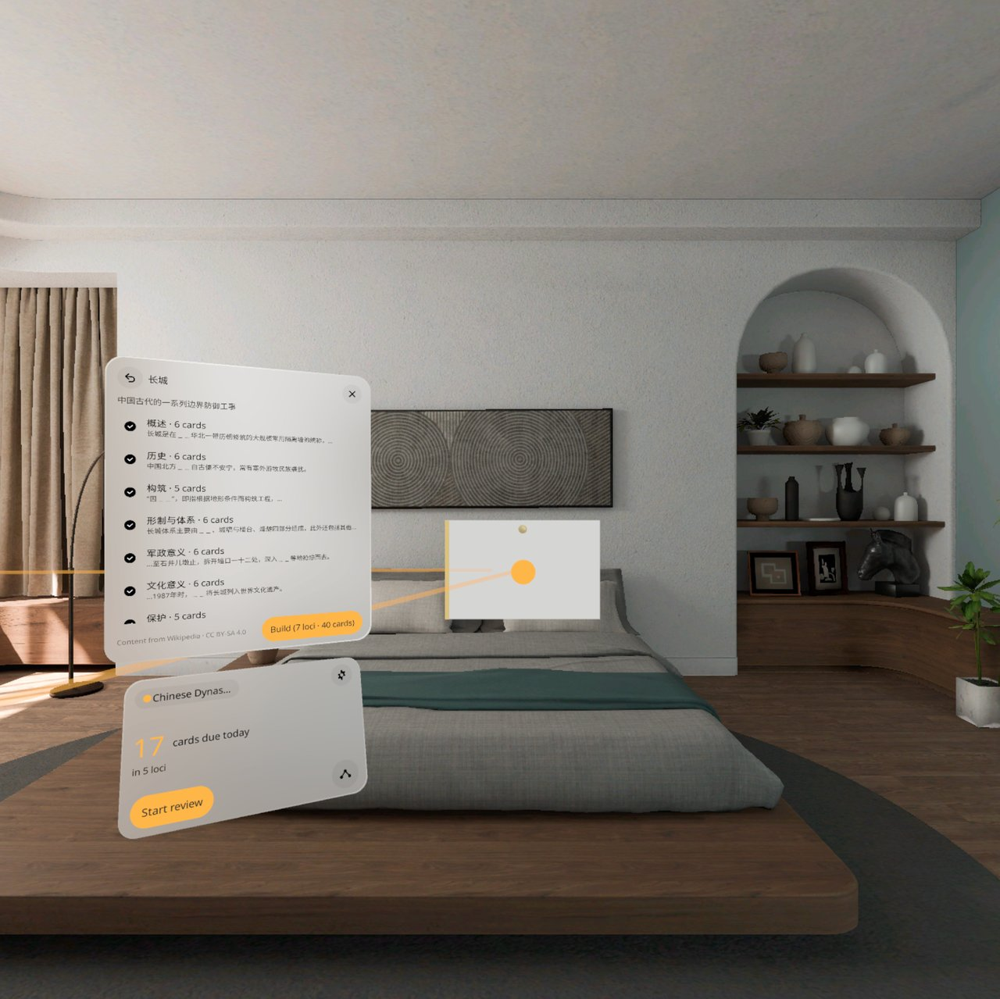
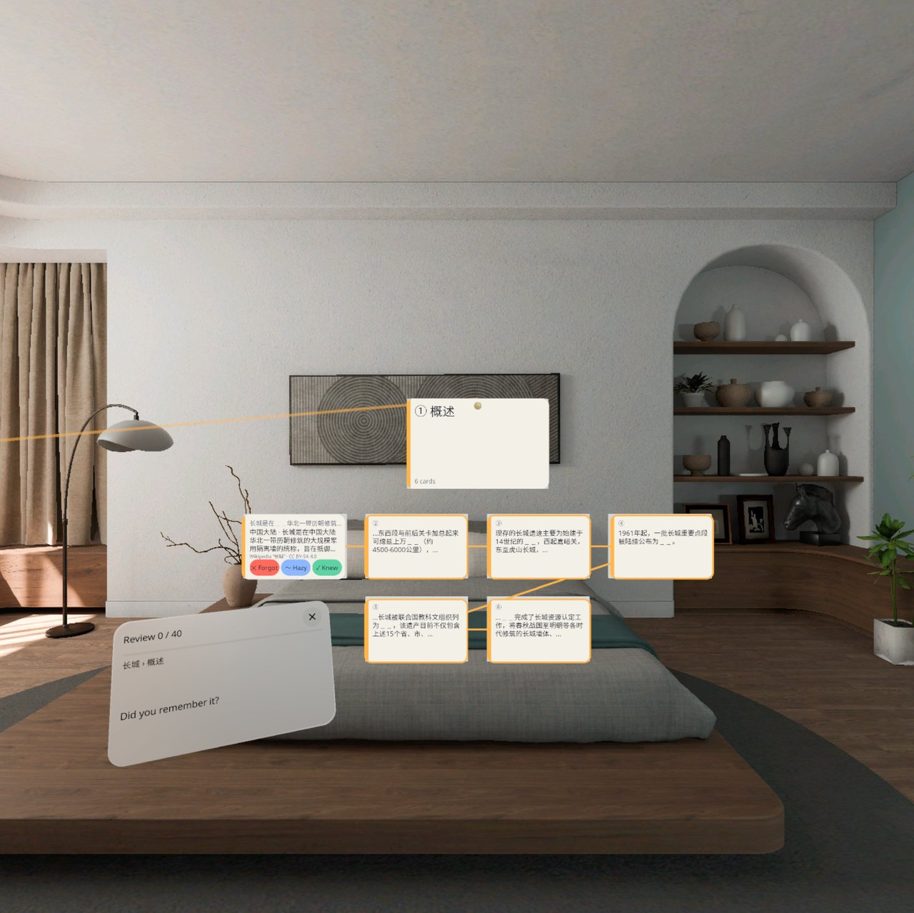
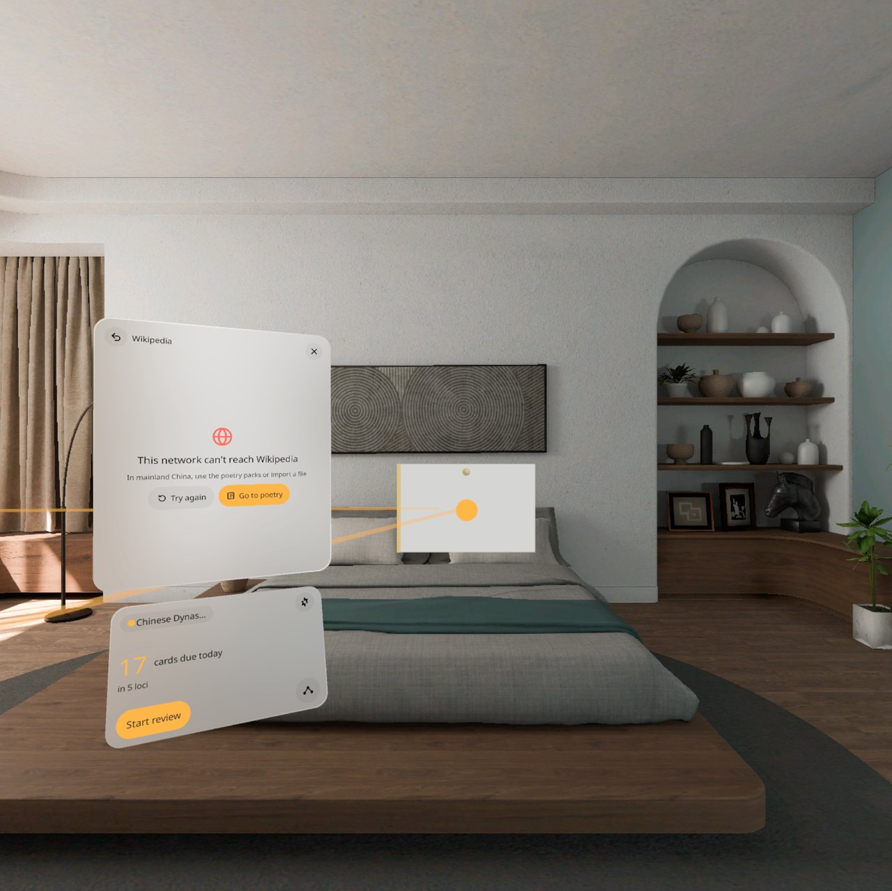
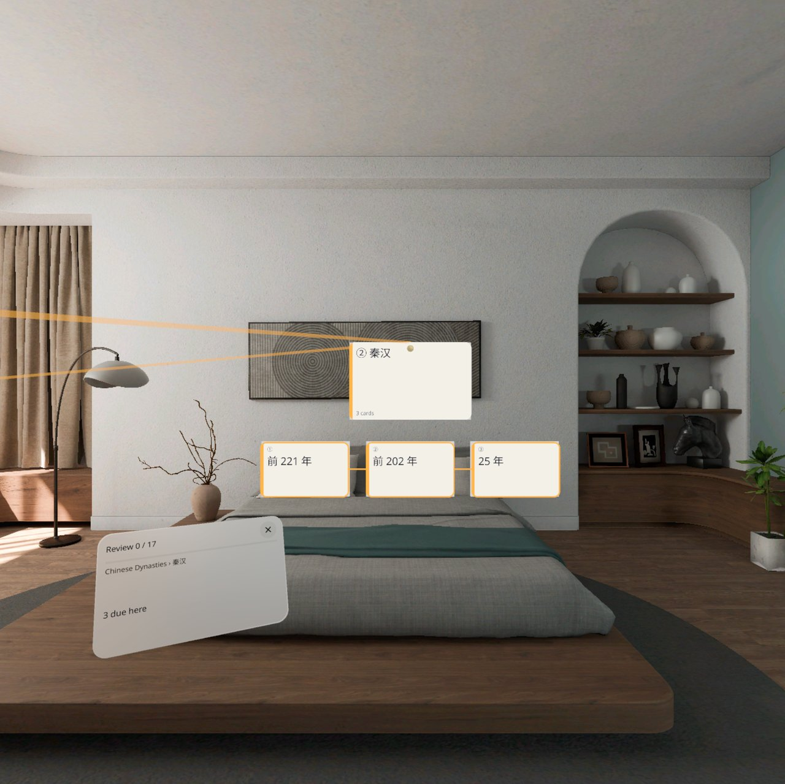

# 记忆宫殿 Memory Palace



**中文** · [English](#english)

把要背的东西做成一座宫殿：位置贴在自己房间的墙上、桌上，连成一条发光的路线；每个位置走到 1 米内才会就地展开成一组卡或子位置，捏一下翻面、评分；走一圈就复习一遍，也可以按路线顺序把整套内容回忆一遍。PICO OS 6 的 MR 应用（Stage · Mixed，只在全空间里运行），无账号。

v0.2 起有现成的内容可背：

- **离线诗词包**：唐诗名篇（5 位诗人 · 14 首 · 34 张卡，默认的第一座宫殿）、宋词名篇（4 位诗人 · 6 首 · 25 张卡）。一个诗人是一个位置，一首诗是一个子位置，一联是一张卡；卡背写出处，如「《春望》· 杜甫」。原文是公有领域，打包在应用里，不联网也能用。
- **用维基百科条目建宫殿（海外网络）**：搜一个条目（中文 / English），每个章节变成一个位置，句子变成填空卡；先预览、勾选要哪些位置，再建成。每张卡背署名「维基百科《条目》· CC BY-SA 4.0」。建好的宫殿存在本地，之后离线复习。
- **中国大陆不接在线百科**：大陆网络打不开维基百科时，应用会提示「这个网络打不开维基百科」，引导去诗词包或从文件导入，不会接其他在线百科。

其他功能：

- 宫殿 → 位置（贴在真实表面，有空间锚点）→ 子位置 → 卡，最深 3 层
- 还预置了中国朝代、前 20 号元素、旅行英语三座宫殿
- 从文件导入：CSV（`正面,背面` 或 `分组,正面,背面`）、Anki 纯文本导出（`::` 牌组层级）、行首缩进 TXT
- 间隔重复：SM-2，凌晨 4 点分日；忘了的卡本轮最后再来一次；评分后 3 秒内可改
- 中英双语界面（跟随系统，可在设置里切换）
- 联网的只有维基百科这一处（需要 `INTERNET` 权限）

## 截图

截图来自 PICO OS 6.1 模拟器（QA 第 2、3 轮，v0.2.x）。模拟器系统语言是英文，所以多数截图界面是英文；第 3 张是中文界面。

| | |
|---|---|
|  唐诗名篇 › 杜甫 ›《春望》：子位置里四联四张卡 |  翻面：国破山河在 → 城春草木深，三档评分 |
|  中文界面：断网时建成的宋词名篇，苏轼《水调歌头》 |  新宫殿 → 诗词包：唐诗 / 宋词，已建的显示「已在宫殿库」 |
|  维基百科「长城」预览：7 个位置 · 40 张卡，可勾选 |  维基卡背面带 CC BY-SA 4.0 署名 |
|  打不开维基百科时：提示并引导去诗词包 / 再试一次 |  走到 1 米内，位置就地展开，琥珀色的线连着路线 |

演示视频：[docs/MemoryPalace-v0.2-demo.mp4](docs/MemoryPalace-v0.2-demo.mp4)（60 秒，1.33 倍速，无声；录的是 v0.2.0）。**这是原生模拟器演示，由调试命令驱动，不是真实手势录像。**

## 安装

需要 PICO OS 6 头显或 PICO 6.1 模拟器。APK 在 [Releases](../../releases) 里（debug 签名）。

```bash
adb install -r MemoryPalace-v0.2.1.apk
pico-cli app launch io.embodit.memorypalace
```

第一次打开会扫描房间（需要几秒），然后进主页。点「开始布置」，看着墙或桌面捏一下就钉一个位置；位置之间至少隔 0.8 米。从 v0.1.0 覆盖安装会保留原有宫殿、进度和锚点。

## 已知问题（v0.2.1）

模拟器 QA 发现，都不影响使用。

第 1 轮（v0.1.0 起就有，这一版没改）：

1. **位置牌牌面空白**：钉好的位置牌是一块瓷白板 + 一个光点，号码、位置名和张数在牌上方的小签里，字比较小。走近展开后标题正常。
2. **冷启动约 1 秒显示错的主页**：重启后锚点加载完之前，先显示「今天完成了」，约 1 秒后变成正确的「待复习」。
3. **卡面刚出现时空白几秒**：位置展开或翻面后，个别卡面先是空白，3–10 秒后字才出来。模拟器面板本来就滞后，真机上可能没有。
4. **子位置角标写法**：显示「周 • 2」，设计是「周 ▸ 2」。
5. **英文宫殿名截断**：英文界面主页里长宫殿名会截断（如「Chinese Dynas…」），中文不截。
6. **调试命令 `palace` 不保存当前宫殿**：只影响 debug 包的 QA 脚本；用面板切换宫殿，重启后会保持。

第 2 轮（v0.2 新功能）：

7. **连不上维基要等约 10 秒才提示**：网络被挡（DNS 失败）时，先显示搜索页约 10 秒，才切到「这个网络打不开维基百科」，这段时间看起来像能搜。
8. **重开维基页保留旧结果**：关掉再打开，上次的搜索词和结果还在，也不重新检测网络；切换中文 / English 后列表仍是旧语言的结果，直到再搜一次。
9. **维基卡背面原句被截断**：卡上只显示 3 行，后面是「…」。
10. **8 张卡的格子第二排被随身面板挡住一部分**：如宋词《水调歌头》，模拟器视角下第二排左侧被盖住，换个站位可能就没有。
11. **宫殿库第一次出现时闪一帧黑块**。
12. **主页副标题少了「14 首」**：显示「34 张卡，最深 3 层」，设计是「14 首 · 34 张卡」；诗词包面板里写全了。
13. **维基请求的 User-Agent 没有联系地址**：Wikimedia 要求带联系方式，正式发布前要补。

另外：维基搜索结果下面那行简介来自 Wikidata，有时是繁体，条目正文是简体。

## 真机待验

v0.2 还没装到真机上（头显上是 v0.1.0），以下都等用户戴上头显验：

- **真实房间里锚点的长期保持**：跨天、关机重开、换光照后能不能把位置找回来，有没有漂移
- 用头显系统键盘输入维基搜索词：中文拼音候选、英文、删除、清空
- 中国大陆真实网络下打开维基页，多久出现「打不开维基百科」的提示
- 诗词卡、维基卡在 1 米处的字看不看得清
- 真实走路时 1.0 米展开 / 1.2 米收起的手感；手部捏合点卡、点标题
- 系统文件选择器（「从文件选择…」）在 PICO OS 6 上能不能用
- 已知问题 3、10 在真机上是否还在

## 内容许可

- 诗词原文为公有领域。
- 用维基百科建出的宫殿内容来自维基百科，按 CC BY-SA 4.0 使用，每张卡背面署名。debug 包里的维基测试样本（`app/src/debug/assets/wiki`）同样是 CC BY-SA 4.0。
- 字体 Noto Sans / Noto Sans SC：SIL OFL 1.1（[third_party/](third_party/)）。

## 开发

Kotlin + PICO Spatial SDK 6.1.9，所有 2D 界面用 SpatialUI（`PicoTheme`），没有 Material。开发说明、调试命令、QA 截图清单见 [AGENTS.md](AGENTS.md)；设计包和样稿在 [design/](design/)（AGENTS.md 里的 `../spatial-app-factory/apps/memory-palace/` 路径对应这里）。

---

<a id="english"></a>

## English

Turn what you need to memorize into a palace: loci are pinned to the walls and tables of your own room and joined by a glowing route. Each locus opens in place into a grid of cards or sub-loci only when you walk within 1 m; pinch to flip a card and rate it. One walk around the room is one review, or walk the route in order and recall the whole set. An MR app for PICO OS 6 (Stage · Mixed, Full Space only). No account.

Since v0.2 there is ready-made content:

- **Offline poetry packs**: Tang Poems (5 poets · 14 poems · 34 cards, the default first palace) and Song Ci (4 poets · 6 poems · 25 cards). A poet is a locus, a poem is a sub-locus, a couplet is a card; the back names the source, e.g. 《春望》· 杜甫. The texts are public domain and ship inside the app, so they work offline.
- **Build a palace from a Wikipedia article (outside mainland China)**: search an article (Chinese / English); each section becomes a locus and its sentences become fill-in cards. Preview, untick the loci you don't want, then build. Every card's back credits Wikipedia and CC BY-SA 4.0. Built palaces are stored locally and reviewed offline.
- **No online encyclopedia in mainland China**: when Wikipedia can't be reached, the app says so and points to the poetry packs or file import. It does not fall back to any other online encyclopedia.

Also:

- Palace → locus (pinned to a real surface with a spatial anchor) → sub-locus → card, up to 3 levels
- Three more bundled palaces: Chinese Dynasties, First 20 Elements, Travel English
- Import from files: CSV (`front,back` or `group,front,back`), Anki plain-text export (`::` deck hierarchy), indented TXT
- Spaced repetition: SM-2, day starts at 4 a.m.; forgotten cards come back once at the end of the round; a rating can be changed within 3 s
- Chinese and English UI (follows the system, switchable in Settings)
- Wikipedia is the only network use (`INTERNET` permission)

### Screenshots

From the PICO OS 6.1 emulator (QA rounds 2 and 3, v0.2.x); see the table above. The demo video [docs/MemoryPalace-v0.2-demo.mp4](docs/MemoryPalace-v0.2-demo.mp4) (60 s, 1.33× speed, no sound, recorded on v0.2.0) is **a native emulator demo driven by debug commands, not a recording of real hand gestures.**

### Install

Needs a PICO OS 6 headset or the PICO 6.1 emulator. The APK (debug-signed) is on the [Releases](../../releases) page.

```bash
adb install -r MemoryPalace-v0.2.1.apk
pico-cli app launch io.embodit.memorypalace
```

On first launch the app scans the room for a few seconds, then shows Home. Tap "Start placing", look at a wall or table and pinch to pin a locus; loci must be at least 0.8 m apart. Installing over v0.1.0 keeps your palaces, progress and anchors.

### Known issues (v0.2.1)

Found in emulator QA; none of them blocks use.

From round 1 (present since v0.1.0, unchanged):

1. **Blank locus plaques**: a pinned plaque shows a porcelain board and a dot; its number, name and card count are in a small label above it.
2. **Wrong home screen for ~1 s on cold start**: before anchors finish loading, Home shows "Done for today", then switches to "Due".
3. **Cards blank for a few seconds** right after a locus opens or a card flips (3–10 s on the emulator; may not happen on a headset).
4. **Sub-locus badge** shows "周 • 2" instead of "周 ▸ 2".
5. **Long palace names truncated in English** on Home (e.g. "Chinese Dynas…"). Chinese is not cut.
6. **Debug `palace` command does not persist the palace**: affects only QA scripts on the debug build.

From round 2 (v0.2 features):

7. **~10 s before the "can't reach Wikipedia" message** when DNS is blocked; until then the search page looks usable.
8. **Reopening the Wikipedia page keeps old results** and does not re-check the network; switching Chinese / English keeps the old list until you search again.
9. **Wikipedia card backs are cut** to 3 lines with "…".
10. **The second row of an 8-card grid is partly behind the pocket panel** from the emulator's viewpoint.
11. **One black frame** when the palace library first appears.
12. **Home subtitle misses "14 poems"**: shows "34 cards, 3 levels deep"; the poetry pack panel has the full line.
13. **The Wikipedia User-Agent has no contact address** yet; Wikimedia asks for one, to be added before a public release.

Also: the one-line descriptions under Wikipedia search results come from Wikidata and are sometimes in Traditional Chinese, while the article text is Simplified.

### To verify on a headset

v0.2 has not been installed on a headset yet (the headset has v0.1.0):

- **Long-term anchor persistence in a real room**: across days, power cycles and lighting changes; drift
- Typing Wikipedia searches with the headset keyboard: Chinese pinyin candidates, English, delete, clear
- On a real mainland China network, how long until the "can't reach Wikipedia" message appears
- Legibility of poetry and Wikipedia cards at 1 m
- Feel of opening at 1.0 m / closing at 1.2 m while walking; hand pinch on cards and titles
- The system file picker ("Choose from files…") on PICO OS 6
- Whether known issues 3 and 10 still happen on a headset

### Content licences

Poem texts are public domain. Palaces built from Wikipedia use Wikipedia content under CC BY-SA 4.0, credited on every card; the debug Wikipedia fixtures (`app/src/debug/assets/wiki`) are CC BY-SA 4.0 too. Fonts Noto Sans / Noto Sans SC: SIL OFL 1.1.

### Development

Kotlin + PICO Spatial SDK 6.1.9; all 2D UI is SpatialUI in `PicoTheme`, no Material. See [AGENTS.md](AGENTS.md) for structure, debug commands and the QA screenshot list; the design package and sample are in [design/](design/).
