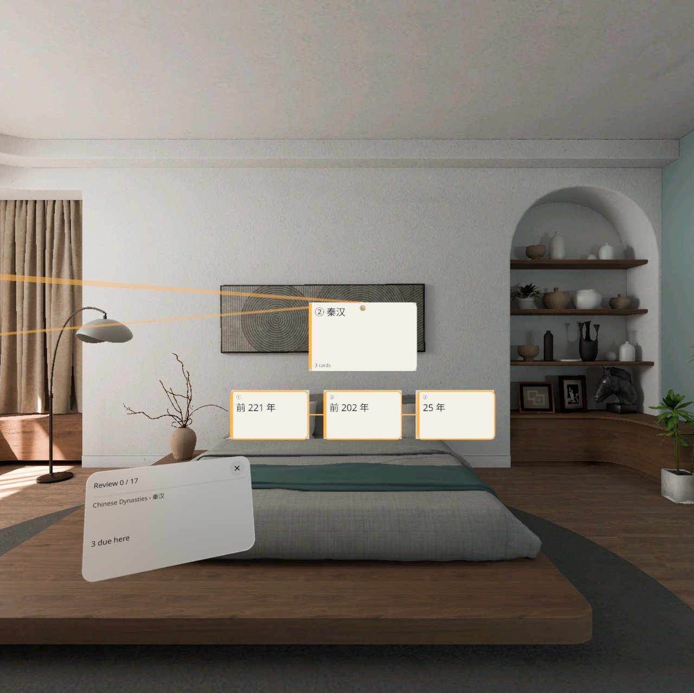
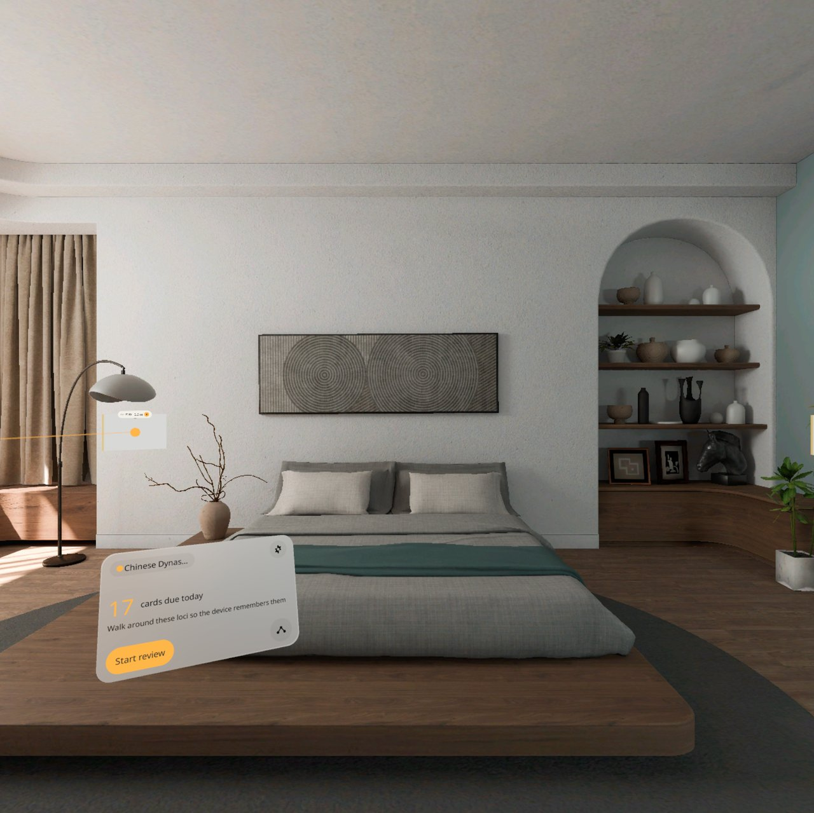
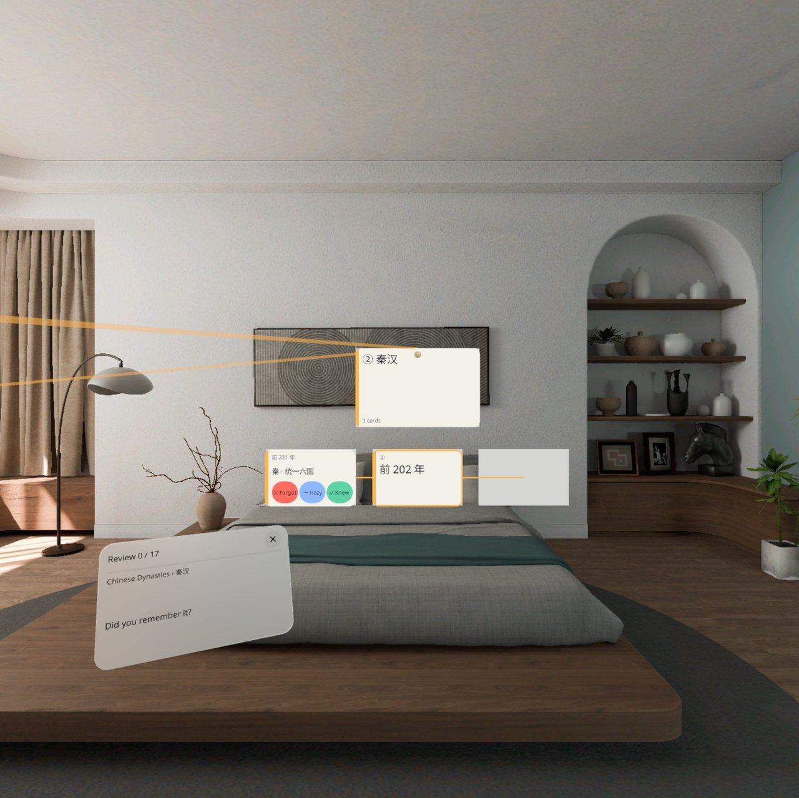
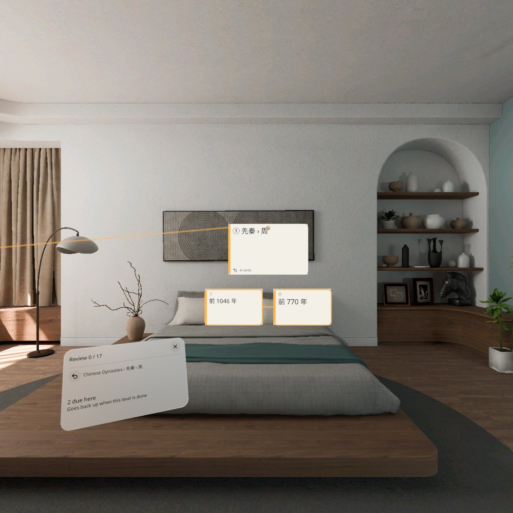
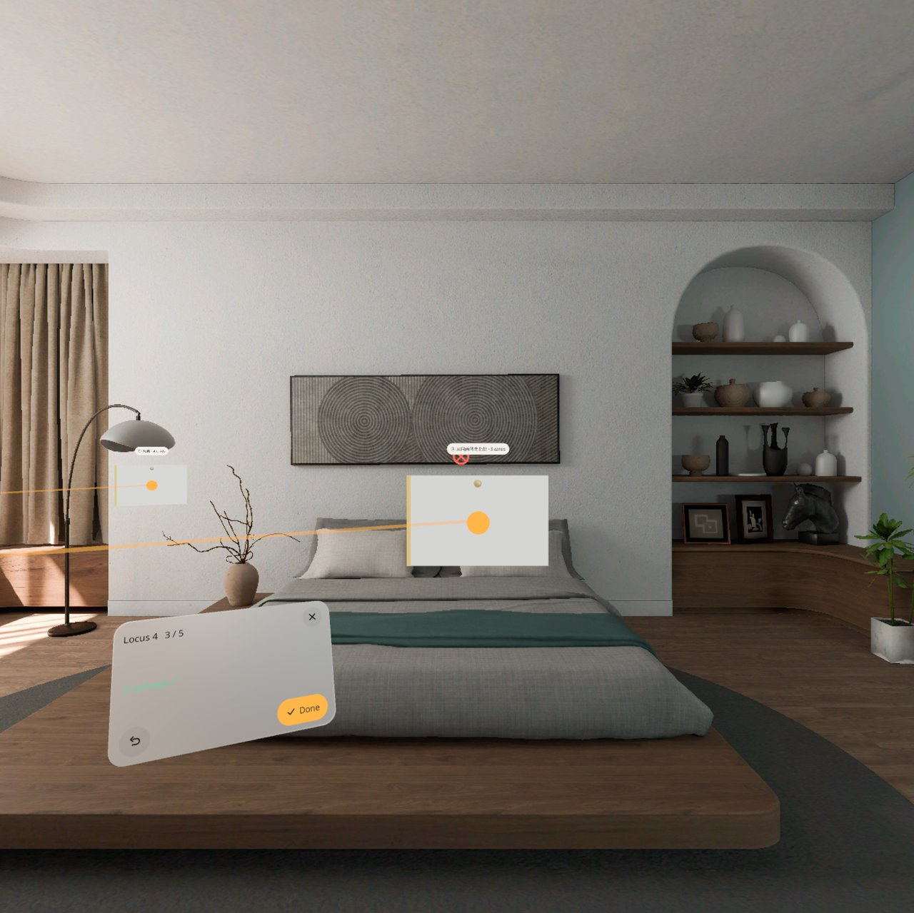
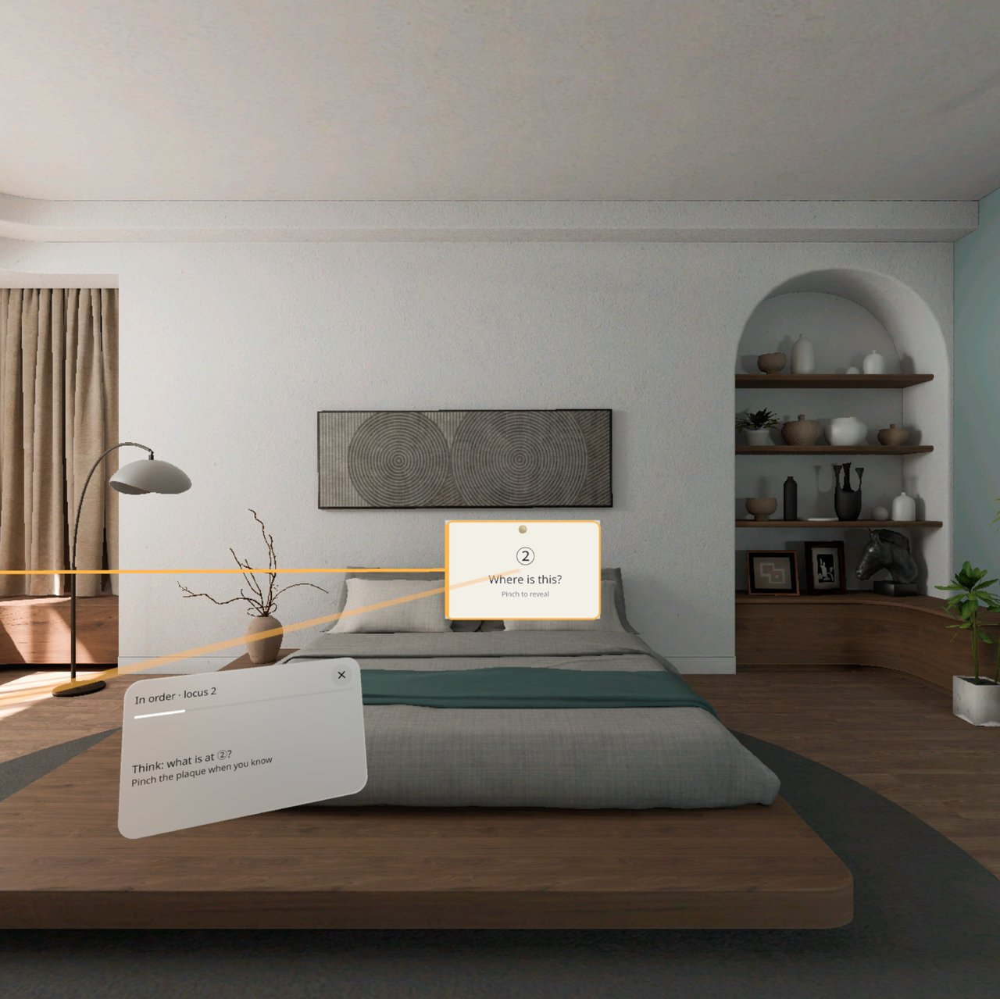
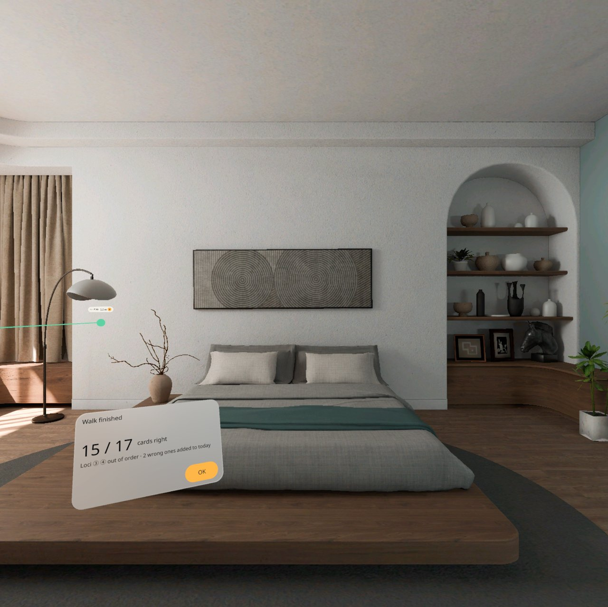

# 记忆宫殿 Memory Palace


**中文** · [English](#english)

把要背的东西做成一座宫殿：位置贴在自己房间的墙上、桌上，连成一条发光的路线；每个位置走到 1 米内才会就地展开成一组卡或子位置，捏一下翻面、评分；走一圈就复习一遍，也可以按路线顺序把整套知识回忆一遍。PICO OS 6 的 MR 应用（Stage · Mixed，只在全空间里运行），完全离线，无账号。

- 宫殿 → 位置（贴在真实表面，有空间锚点）→ 子位置 → 卡，最深 3 层
- 预置三座宫殿：中国朝代（5 个位置 · 17 张卡 · 3 层）、前 20 号元素、旅行英语
- 导入：CSV（`正面,背面` 或 `分组,正面,背面`）、Anki 纯文本导出（`::` 牌组层级）、行首缩进 TXT
- 间隔重复：SM-2，凌晨 4 点分日；忘了的卡本轮最后再来一次；评分后 3 秒内可改
- 顺序走：按路线顺序走到每个位置，先回忆再翻；走错顺序会提示先去哪一个
- 中英双语（跟随系统，可在设置里切换）

## 截图

截图来自 PICO OS 6.1 模拟器（QA 第 1 轮，v0.1.0）。模拟器界面是英文。

| | |
|---|---|
|  走到 ② 秦汉 1 米内：位置就地展开成标题 + 3 张卡，琥珀色的线连着路线 |  主页：今天 17 张待复习，随身面板跟在手边 |
|  捏一下翻面，三档评分（忘了 / 模糊 / 记得） |  进入子位置「先秦 › 周」：第 2 层的卡 |
|  布置：看着墙捏一下，把位置钉在墙上 |  顺序走：走到 ② 先想「这里是什么」，再翻开 |
|  顺序走结果：15 / 17 | |

演示视频：[docs/MemoryPalace-demo.mp4](docs/MemoryPalace-demo.mp4)（60 秒，无声）。**这是原生模拟器演示，由调试命令驱动，不是真实手势录像。**

## 安装

需要 PICO OS 6 头显或 PICO 6.1 模拟器。APK 在 [Releases](../../releases) 里（debug 签名）。

```bash
adb install -r MemoryPalace-v0.1.0.apk
pico-cli app launch io.embodit.memorypalace
```

第一次打开会扫描房间（需要几秒），然后进主页。点「开始布置」，看着墙或桌面捏一下就钉一个位置；位置之间至少隔 0.8 米。

## 已知问题（v0.1.0）

模拟器 QA 第 1 轮发现，都不影响使用：

1. **位置牌牌面空白**：钉好的位置牌是一块瓷白板 + 一个光点，号码、位置名和张数在牌上方的小签里，字比较小。走近展开后标题正常。
2. **冷启动约 1 秒显示错的主页**：重启后锚点加载完之前，先显示「今天完成了」，约 1 秒后变成正确的「待复习」。
3. **卡面刚出现时空白几秒**：位置展开或翻面后，个别卡面先是空白，3–10 秒后字才出来。模拟器面板本来就滞后，真机上可能没有，待真机确认。
4. **子位置角标写法**：显示「周 • 2」，设计是「周 ▸ 2」。
5. **英文宫殿名截断**：英文界面主页里「Chinese Dynasties」截成「Chinese Dynas…」，中文不截。
6. **调试命令 `palace` 不保存当前宫殿**：只影响 debug 包的 QA 脚本；用面板切换宫殿，重启后会保持。

## 真机待验

应用已装在 PICO 头显上（v0.1.0），下面这些模拟器验不了，要戴上头显看：

- **真实房间里锚点的长期保持**：跨天、关机重开、换光照后能不能把位置找回来，有没有漂移（模拟器只证明了同一会话内重启 5 次都能找回）
- 真实走路时 1.0 米展开 / 1.2 米收起的手感，两个位置靠得近时「一次只开一个」是否稳定
- 1 米处卡面字和距离小签看不看得清
- 手部捏合点卡、点标题（模拟器用的是鼠标注视 + 捏合）
- 系统文件选择器（「从文件选择…」）在 PICO OS 6 上能不能用
- 「无空间权限」页的真实触发（锚点持续返回 -5 或平面检测启动失败）
- 已知问题 3 在真机上是否还在

## 开发

Kotlin + PICO Spatial SDK 6.1.9，所有 2D 界面用 SpatialUI（`PicoTheme`），没有 Material。开发说明、调试命令、QA 截图清单见 [AGENTS.md](AGENTS.md)；设计包和样稿在 [design/](design/)（AGENTS.md 里的 `../spatial-app-factory/apps/memory-palace/` 路径对应这里）。

---

<a id="english"></a>

## English

Turn what you need to memorize into a palace: loci are pinned to the walls and tables of your own room and joined by a glowing route. Each locus opens in place into a grid of cards or sub-loci only when you walk within 1 m; pinch to flip a card and rate it. One walk around the room is one review. You can also walk the route in order and recall the whole set. An MR app for PICO OS 6 (Stage · Mixed, Full Space only). Fully offline, no account.

- Palace → locus (pinned to a real surface with a spatial anchor) → sub-locus → card, up to 3 levels
- Three bundled palaces: Chinese Dynasties (5 loci · 17 cards · 3 levels), First 20 Elements, Travel English
- Import: CSV (`front,back` or `group,front,back`), Anki plain-text export (`::` deck hierarchy), indented TXT
- Spaced repetition: SM-2, day starts at 4 a.m.; forgotten cards come back once at the end of the round; a rating can be changed within 3 s
- Recall in order: walk to each locus in route order and recall before you flip; going out of order tells you where to go first
- Chinese and English (follows the system, switchable in Settings)

### Screenshots

From the PICO OS 6.1 emulator (QA round 1, v0.1.0); see the table above. The demo video [docs/MemoryPalace-demo.mp4](docs/MemoryPalace-demo.mp4) (60 s, no sound) is **a native emulator demo driven by debug commands, not a recording of real hand gestures.**

### Install

Needs a PICO OS 6 headset or the PICO 6.1 emulator. The APK (debug-signed) is on the [Releases](../../releases) page.

```bash
adb install -r MemoryPalace-v0.1.0.apk
pico-cli app launch io.embodit.memorypalace
```

On first launch the app scans the room for a few seconds, then shows Home. Tap "Start placing", look at a wall or table and pinch to pin a locus; loci must be at least 0.8 m apart.

### Known issues (v0.1.0)

Found in emulator QA round 1; none of them blocks use:

1. **Blank locus plaques**: a pinned plaque shows a porcelain board and a dot; its number, name and card count are in a small label above it, in small type. The title is fine once the locus opens.
2. **Wrong home screen for ~1 s on cold start**: before anchors finish loading, Home shows "Done for today", then switches to "Due" about 1 s later.
3. **Cards blank for a few seconds**: right after a locus opens or a card flips, some card faces are blank for 3–10 s. Emulator panels lag anyway; may not happen on a headset (to be checked).
4. **Sub-locus badge**: shows "周 • 2" instead of the designed "周 ▸ 2".
5. **English palace name truncated**: "Chinese Dynasties" is cut to "Chinese Dynas…" on Home in English. Chinese is not cut.
6. **Debug `palace` command does not persist the palace**: affects only QA scripts on the debug build; switching from the panel persists across restarts.

### To verify on a headset

- **Long-term anchor persistence in a real room**: across days, power cycles and lighting changes; drift (the emulator only proved recovery across 5 restarts in one session)
- Feel of opening at 1.0 m / closing at 1.2 m while really walking; "one locus open at a time" when two loci are close
- Legibility of card text and distance labels at 1 m
- Hand pinch on cards and titles (the emulator used mouse gaze + pinch)
- The system file picker ("Choose from files…") on PICO OS 6
- The real trigger of the "no spatial access" page (anchors keep returning -5, or plane detection fails to start)
- Whether known issue 3 still happens on a headset

### Development

Kotlin + PICO Spatial SDK 6.1.9; all 2D UI is SpatialUI in `PicoTheme`, no Material. See [AGENTS.md](AGENTS.md) for structure, debug commands and the QA screenshot list; the design package and sample are in [design/](design/).
